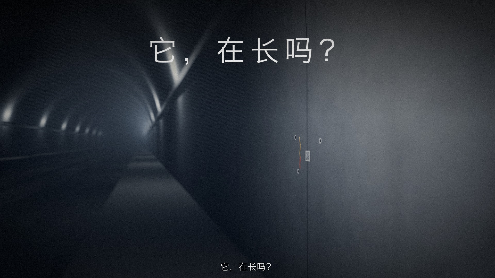
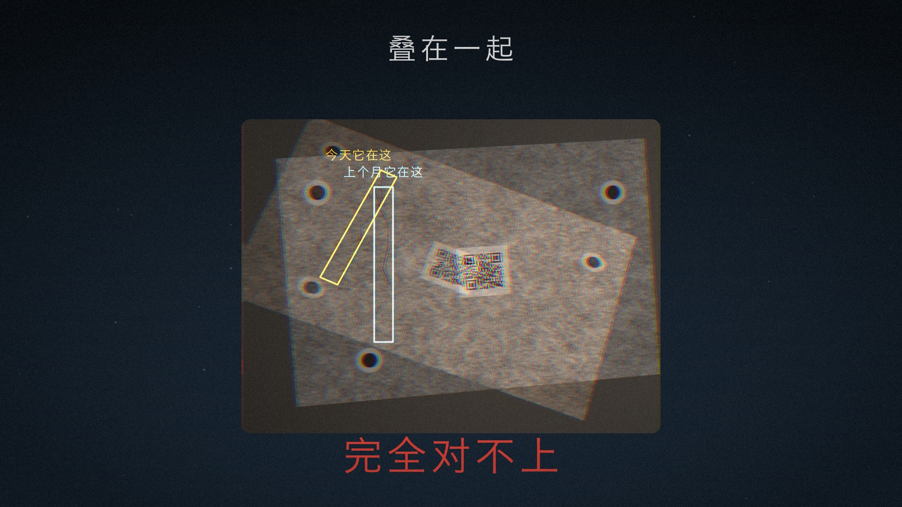
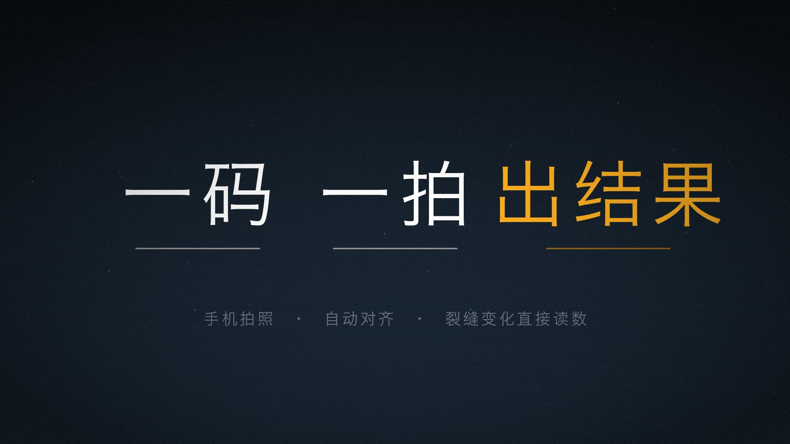
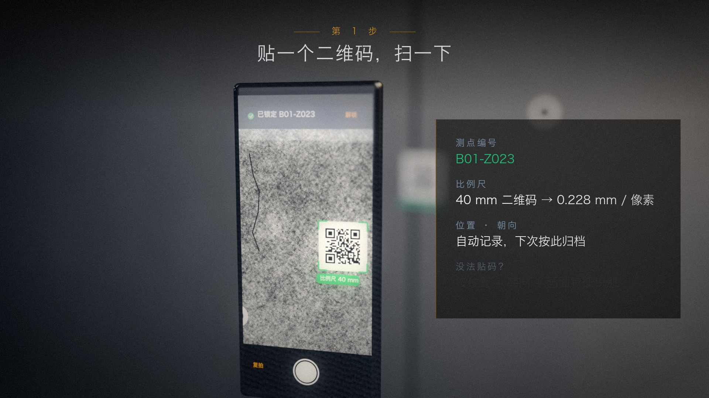
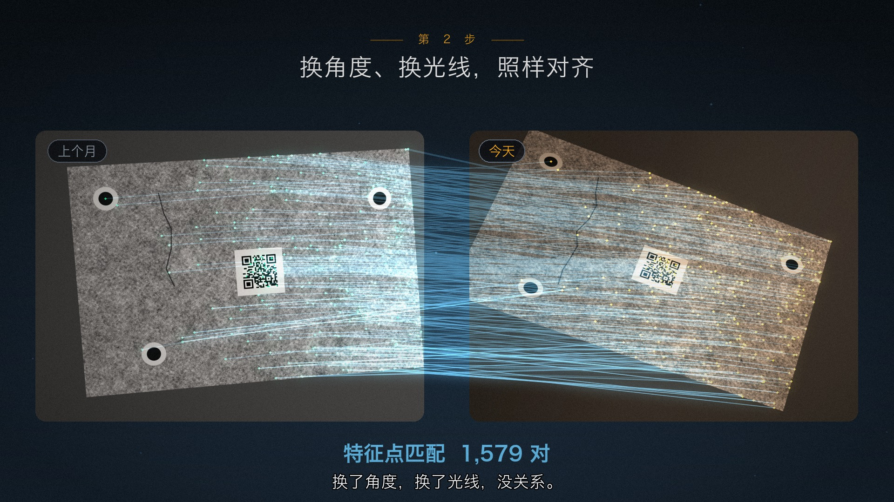
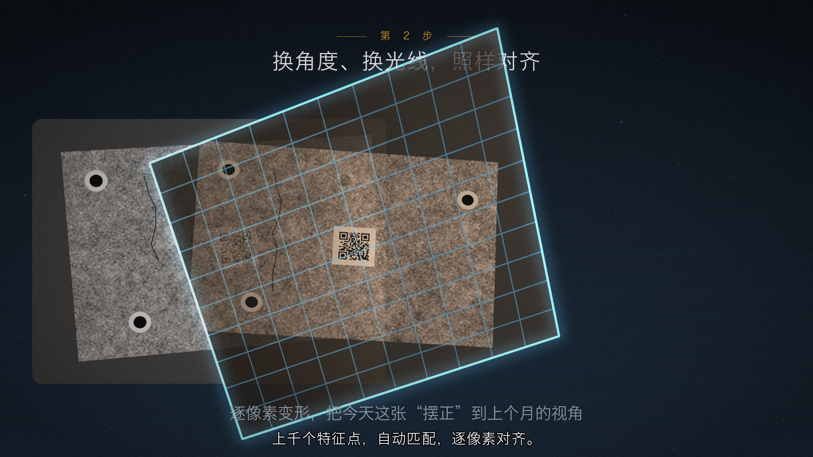
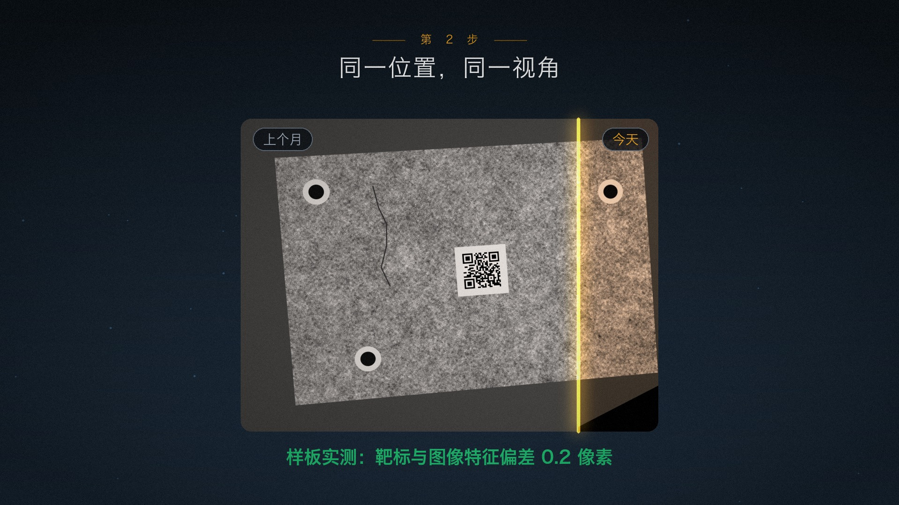
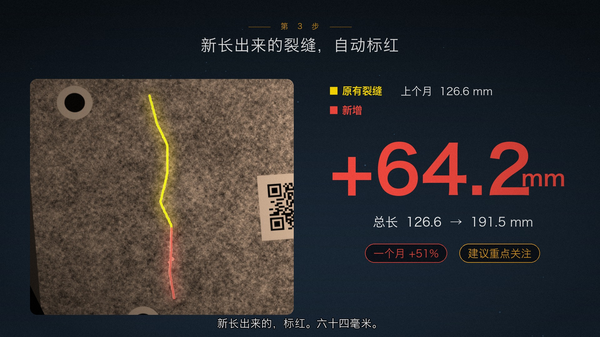
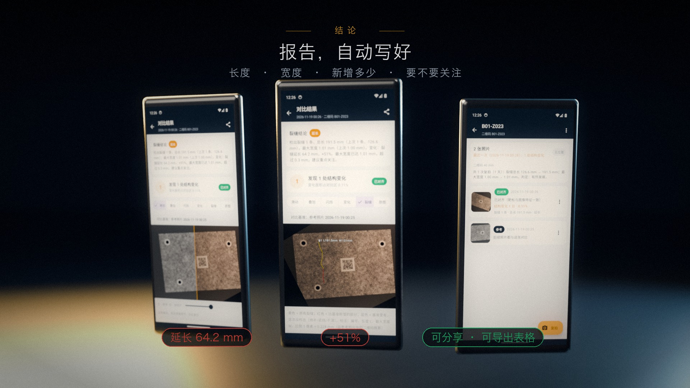
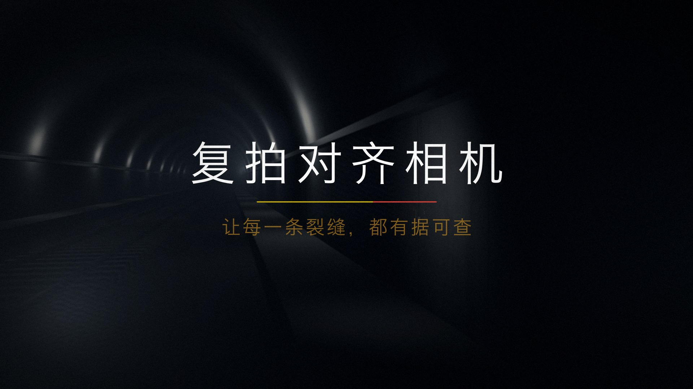

# 复拍对齐相机 · 宣传文案

> 配套视频（63 秒，Blender 三维镜头 + 原创配乐 + 豆包大模型旁白）：
> - 横版 1920×1080：[宣传片_横版.mp4](宣传片_横版.mp4)（官网、B 站、汇报投屏）
> - 竖版 1080×1920：[宣传片_竖版.mp4](宣传片_竖版.mp4)（抖音、视频号、朋友圈）
>
> 隧道、两次机位、扫码和手机展示是 Blender 建模渲染的三维镜头：衬砌上的裂缝、二维码和标记点，就是 `samples/promo` 两张样板照片拍的那块墙面，位置一一对应。对齐、特征连线、变形、裂缝标注和读数是这对照片的真实处理结果；手机屏幕是 App 真实截图。

---

## 一、主打噱头

| | 主标题 | 副标题 |
|---|---|---|
| **A（推荐，片中使用）** | **一码，一拍，出结果** | 这条裂缝一个月长了多少毫米，手机直接告诉你 |
| B | **换了角度，换了光线，照样对得上** | 上千个特征点自动匹配，逐像素对齐 |
| C | **给每一条裂缝，建一份"成长档案"** | 扫码归档，复拍对比，走势一目了然 |

短视频封面字：**"它，在长吗？"**（配隧道里发红的裂缝那一帧）

---

## 二、公众号 / 朋友圈长文案

### 隧道深处，一条裂缝。它，在长吗？

巡检的人都懂，这个问题有多难回答。

上个月明明拍过它。可相册里是上千张几乎一样的墙，哪张才是它？

好不容易翻出来了——**今天再拍，角度变了，光线变了，远近也变了**。两张照片叠在一起：

完全对不上。裂缝到底是"长了"，还是"看着像长了"，谁也说不清。

### 一码，一拍，出结果

### 第 1 步：贴一个二维码，扫一下

在裂缝旁边贴一个小二维码，扫一下，测点编号就锁定了。它同时还是**比例尺**——二维码的尺寸是已知的，像素就能换算成毫米，不用靠尺。

拍摄位置、镜头朝向也一起记下来，下次自动归档。没法贴码的地方，按位置 + 朝向 + 画面特征也能认出"这是哪一处"。

### 第 2 步：换角度、换光线，照样对齐

下次来，随手再拍一张。App 在两张照片里找出**上千个相同的特征点**，一一配对：

再把今天这张逐像素"摆正"到上个月的视角。

同一位置，同一视角，严丝合缝。

### 第 3 步：新长出来的裂缝，自动标红

原有的裂缝标黄，**新长出来的那一段标红**，长了多少直接读数。

### 结论，自动写好

裂缝几条、总长多少、最宽多少、比上次长了多少、要不要重点关注——一段话写好，可以直接分享，也可以整个测点导出成表格和图片。

### 不止是拍照

- **一个二维码**：既是测点编号，又是比例尺
- **离线可用**：不联网、不传云，隧道里照样跑
- **自动归档**：每个测点一份"成长档案"，裂缝总长的走势一眼看出是否在发展
- **现场把关**：反光、模糊、偏暗，当场提醒重拍

适用于隧道二衬、桥梁、铁路沿线、水运工程等需要**定期复拍、前后对比**的裂缝与渗水点。

**复拍对齐相机——让每一条裂缝，都有据可查。**

（竖版配图在 `素材/竖_*.jpg`，适合朋友圈九宫格和小红书。）

---

## 三、短视频平台文案

**标题**：隧道里这条裂缝，一个月长了 6 厘米？手机拍一张就知道

**正文**：
上个月拍过的裂缝，今天再拍——角度变了、光线变了、远近也变了，两张照片根本对不上。
现在：贴一个二维码 → 扫码 → 拍照。
上千个特征点自动匹配，逐像素对齐，新长出来的裂缝直接标红，长了多少毫米一目了然。
不用三脚架，不用靠尺，不用联网。

**话题**：#工程检测 #隧道巡检 #桥梁检测 #裂缝监测 #智慧工地

---

## 四、旁白与分镜（63 秒，120 BPM）

| 时间 | 画面 | 旁白 | 音乐 |
|---|---|---|---|
| 0–6 s | 三维隧道推进，转向侧壁，停在裂缝前；原有段泛琥珀色，新增段转红 | 隧道深处，一条裂缝。它，在长吗？ | 低频长音 + 心跳 |
| 6–9.5 s | 相册照片墙飞速滚动 | 上个月，你明明拍过它。 | 滴答声 + 低音脉冲 |
| 9.5–13 s | 三维：上个月正面冷光机位 → 今天斜拍侧光机位（视锥标出取景范围） | 今天再拍，角度、光线、远近全变了。 | 压迫感渐强 |
| 13–16 s | 两张真实照片半透明叠加，重影漂移 | 叠在一起，完全对不上。 | 故障音 + 上升音效 → 留白 |
| 16–20 s | 一码 / 一拍 / 出结果 | 一码，一拍，出结果。 | 重击，三字各一记 |
| 20–26 s | 三维：手机抬起对准二维码，扫描光带掠过，数据面板 | 贴一个二维码，扫一下，测点就此锁定。 | 鼓点进入 |
| 26–30 s | 两张照片间特征点连线 | 换了角度，换了光线，没关系。 | 主节奏 + 琶音 |
| 30–36 s | 网格变形对齐、滑动对比 | 上千个特征点，自动匹配，逐像素对齐。 | 军鼓滚奏推进 |
| 36–46 s | 放大裂缝，标黄 → 标红 + 火花 + 读数 | 原有的裂缝，标黄。新长出来的，标红。六十四毫米。 | 高潮，读数定格处重击 |
| 46–52 s | 三维：三部手机展示 App 真实截图 | 长度、宽度、发展趋势，结论自动写好。 | 主旋律 |
| 52–57 s | 四张卖点卡片快切 | 一个二维码，就是比例尺。离线可用，自动归档。 | 每张一记和弦 |
| 57–63 s | 三维：从裂缝前后退回隧道中线，片名浮现 | 复拍对齐相机。让每一条裂缝，都有据可查。 | 重击后长和弦渐弱 |

- 配乐是脚本用正弦波和噪声**程序合成的原创音乐**（`make_audio.py`），没有使用任何第三方音乐，不存在版权问题。
- 旁白是豆包语音合成 2.0，音色「大壹」（`make_audio.py`，凭据沿用 robot 项目钥匙串里的豆包密钥）。`素材/试音/` 有大壹、云舟、悬疑解说、儒雅逸辰四个音色的试听；换音色：`DB_VOICE=zh_male_m191_uranus_bigtts ../.venv/bin/python make_audio.py`。`素材/配乐_无旁白.wav` 是纯配乐。

---

## 五、对外宣传时请注意（实话实说的边界）

这些说法**有测试数据支持**，可以放心用：
- 自动对齐、特征点匹配、新增裂缝标红、长度宽度读数、文字结论、离线运行、自动归档和走势——App 里都已实现。
- 片中"特征点匹配 1,579 对""靶标与图像特征偏差 0.2 像素""+64.2 mm""126.6 → 191.5 mm"都是这对样板照片的实测值（片中已标注"样板实测"）。
- 合成样板测试：比例尺误差 < 1%，新增长度误差 < 5%。
- 公开真实裂缝照片数据集测试：裂缝延长检出率 99%，无变化误报约 6%。

这些说法**现在还不能说**：
- "任何微小变化都能发现"——新增长度约 40 像素以上才会报（1 米处拍摄约等于 **1 cm**），更短的延长不报，这是为了不误报。
- "精度达到 0.0x 毫米""替代裂缝宽度仪"——宽度误差约 1 个像素（1 米处拍约 0.2 mm），细于 2 像素的裂缝只能给上限。
- "已在某某隧道/桥梁应用"——目前只在合成样板、公开数据集和模拟器上验证过，**还没有真机现场数据**。片中隧道画面是三维示意动画，不是实拍。
- "AI 大模型识别"——用的是传统图像算法，不是神经网络。
- "渗水自动识别"——目前只能标出"明暗变化（可能为渗水、水渍或阴影）"，需要人工确认。

**最能提升说服力的一步**：拍一组现场真实裂缝的前后照片（最好带一段现场实拍视频），替换掉片中的样板照片——把 `samples/promo/` 里两张照片换掉、重新截 App 截图、改 `film_script.py` 末尾的四个数字，再依次运行 `blender/render_all.sh`、`make_audio.py`、`make_film.py h`、`make_film.py v` 即可（三维镜头里的墙面贴图由 `blender/make_textures.py` 从样板生成，换真实照片后可改成直接用照片做贴图）。
